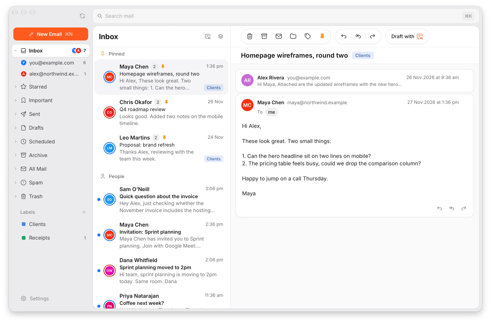
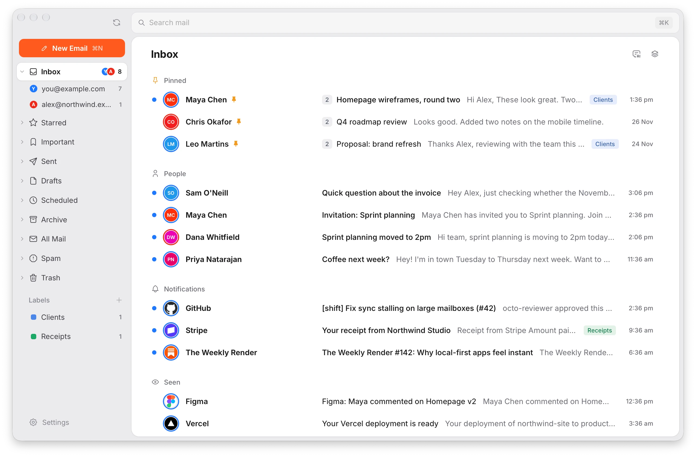
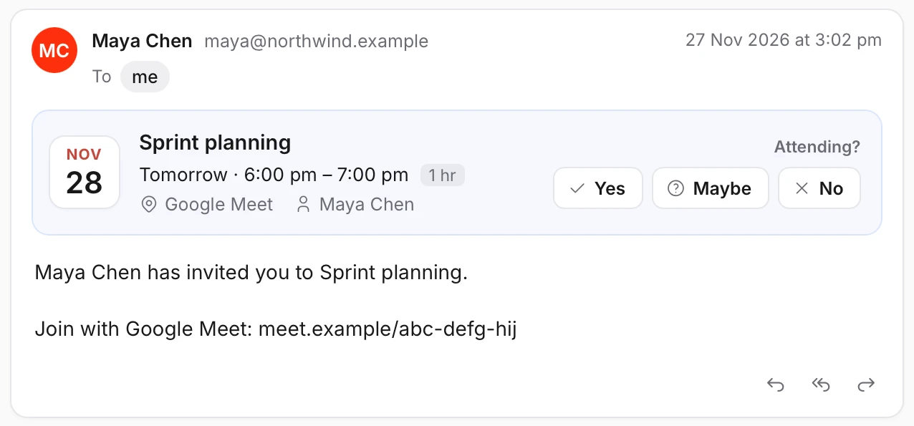
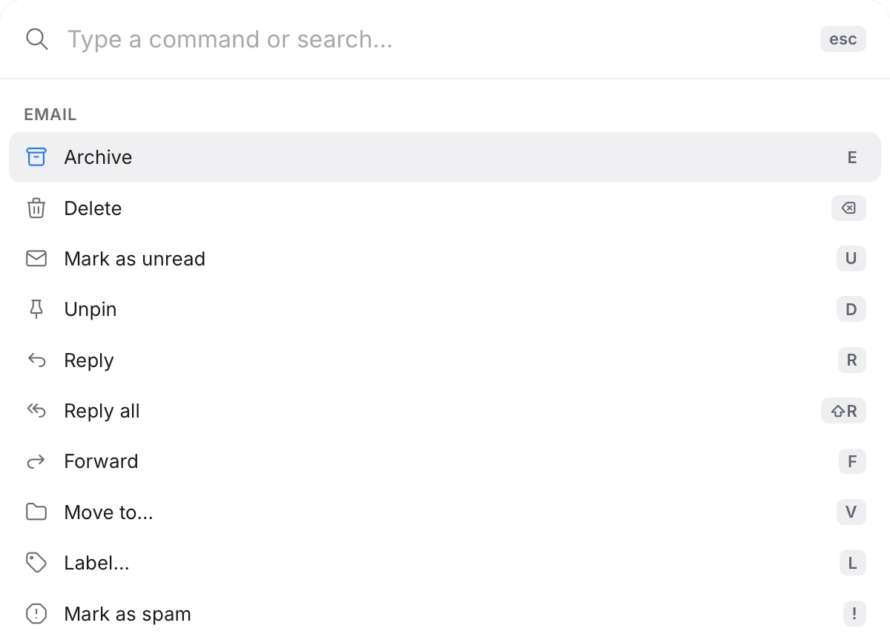

<p align="center">
  
</p>

<h1 align="center">Shift</h1>

<p align="center">
  A fast, keyboard-friendly email app for macOS: Gmail, iCloud, Fastmail or your own domain in one inbox. Free and open source.<br>
  <a href="https://getshiftmail.com/download"><b>Download for macOS</b></a> ·
  <a href="https://getshiftmail.com">Website</a> ·
  <a href="https://getshiftmail.com/changelog">Changelog</a> ·
  <a href="https://github.com/nboada/Shift/releases/latest">Latest release</a>
</p>

<p align="center">
  
</p>

Shift keeps a copy of your mail in a local database, so opening, searching and switching accounts never waits on the network. Changes sync with Gmail or your IMAP server in the background. The app is a Rust core (Tauri 2) with a vanilla TypeScript UI, signed and notarized, and it offers new versions when they're out.

## Features

- **Several accounts, one inbox.** Gmail, plus any IMAP account (iCloud, Fastmail, Yahoo, your own domain). A unified view, or one account at a time.
- **Smart Inbox.** Pinned mail first, then new mail from people, then notifications, then what you've seen. Or a plain newest-first list.
- **Split or wide.** Read with the list beside the email, or give the list the whole window.
- **Keyboard first.** Single-key shortcuts (`E` archive, `R` reply, `J`/`K` next and previous), Apple Mail's ⌘ shortcuts, a ⌘K command palette, and every binding can be remapped.
- **Send later and undo send.** Schedule emails for later today, tomorrow morning, next week or any time.
- **Calendar invites inline.** Answer Yes, Maybe or No from the email itself.
- **A proper composer.** Rich text, signatures, attachments by drag and drop, drafts saved to Gmail as you type.
- **Optional AI with your own key.** Draft replies, rewrite text, sort mail into your labels and suggest clean-ups (Anthropic or any OpenAI-compatible API).
- **Works offline.** Read, archive and label without a connection; changes go through when you're back online.
- **No Shift servers.** Mail goes between your Mac and your mail provider only.

<p align="center">
  
</p>

<table>
  <tr>
    <td></td>
    <td></td>
  </tr>
  <tr>
    <td align="center">Answer invites without leaving your inbox</td>
    <td align="center">Everything is one ⌘K away</td>
  </tr>
</table>

<details>
<summary><b>Keyboard shortcuts</b></summary>

Spark-style single keys and Apple Mail's ⌘ shortcuts both work, and every action can be remapped in Settings → Keyboard shortcuts. The defaults live in `src/keys.ts`.

| Action | Keys |
|---|---|
| New email | `C`, `⌘N` |
| Send (composer) | `⌘↩`, `⇧⌘D` |
| Search | `/`, `⌘F` |
| Check for mail | `⌘R` |
| Next / previous email | `J` `K`, `↓` `↑`, `→` `←` |
| Select all (up to 100) | `⌘A` |
| Select several | `⌘`-click, `⇧`-click |
| Archive | `E`, `⌃⌘A` |
| Delete | `⌫`, `Delete`, `#` |
| Mark read / unread | `U`, `⇧⌘U` |
| Pin | `D`, `⇧⌘L` |
| Reply | `R` |
| Reply all | `⇧R`, `A`, `⇧⌘R` |
| Forward | `F`, `⇧⌘F` |
| Label | `L` |
| Move to | `V`, `⇧⌘M` |
| Spam | `!`, `⇧⌘J` |
| Command palette | `⌘K` |
| Settings | `⌘,` |
| Zoom in / out / actual size | `⌘+` `⌘−` `⌘0` |
| Undo archive, delete, spam or move | `⌘Z` |
| Close menu / clear selection / back | `Esc` |

</details>

## How it works

<details>
<summary><b>Accounts</b></summary>

Each account, Gmail or IMAP, has its own database in `accounts/<email>.sqlite3` (app data folder) and its own Keychain item: a Gmail account's refresh token, an IMAP account's password. IMAP folders show as labels, and applying a label moves the email into that folder. The sidebar switches between **All accounts** (unified; accounts can opt out in Settings → Accounts) and each account. Add accounts from Settings → Accounts, the ⌘K palette, or the first-run screen. The single-account layout (`mail.sqlite3` + one Keychain item) migrates on first launch. Demo mode has two in-memory accounts.

</details>

<details>
<summary><b>Composer</b></summary>

New emails, replies and forwards open in a resizable window (Settings → Composer can open replies inline under the thread instead). The body is a rich-text editor (Tiptap): ⌘B, ⌘I, ⌘U and ⌘K (link) format text, and a small toolbar appears over a selection with lists and quote too. Replies and forwards quote the original as a blockquote, with your signature above it in the editor. Mail goes out as HTML with a plain-text version. Recipients are chips with autocomplete from people you've emailed (`suggest_contacts`). A new email becomes a draft once something is written (10 characters, a recipient or a file). Drafts save to Drafts about 1.5s after you stop typing (15s when over 1 MB of files is attached, since Gmail re-uploads them on every save), and closing keeps the draft (if it can't be saved, the composer stays open). Emails in Drafts reopen in the composer. Sending a saved draft uses `drafts.send`, which removes it from Drafts. Undo send holds the email for a few seconds through the same queue as Send later, so quitting during the countdown still sends it.

Attach files with the paperclip or by dropping them on the composer (25 MB in total, Gmail's limit). Forwarding includes the original attachments. In the reader, attachments are listed under each message. Click one to save it to Downloads and open it. Apps, scripts and other unusual file types are shown in Finder instead of being opened. Inline images (`cid:`) load on demand.

</details>

<details>
<summary><b>Send later</b></summary>

The clock next to Send schedules the email: Later today, Tomorrow morning, This weekend, Next week (set in Settings → Scheduling), or a date and time you pick. Gmail's API has no scheduled send, so the email is saved to Gmail Drafts and Shift sends it when it's due. Shift has to be open at that time; anything overdue goes out the next time it opens. The **Scheduled** mailbox lists what's waiting: click one to edit it (that cancels its schedule until you send or schedule it again), or right-click to send now or cancel.

</details>

<details>
<summary><b>Settings</b></summary>

Open with the gear in the sidebar or `⌘,`. Preferences are saved to `settings.json` in the app data folder; AI provider keys go to the macOS Keychain.

</details>

## Building from source

1. Google Cloud Console: create a project, enable the **Gmail API**, set up the OAuth consent screen (add your account as a test user, and the `https://mail.google.com/` scope, which Empty Trash/Spam needs to delete mail permanently), then create an OAuth client of type **Desktop app**.
2. Put the client credentials in `.env.local` (git-ignored) as `GOOGLE_CLIENT_ID=` and `GOOGLE_CLIENT_SECRET=`, then run:

```sh
bun install
bun run tauri dev   # build.rs bakes GOOGLE_CLIENT_ID/SECRET from .env.local into the binary
```

Before public release, see `docs/google-verification.md`.

### Demo mode

`bun run demo` opens two fake accounts held in memory, reset on every launch, with their own settings file. Nothing talks to Gmail: actions only change the local cache, search is local and Send is a no-op. Use it when working on the UI. Only one of `tauri dev` and `demo` can run at a time (both use port 1420).

### Layout

- `src-tauri/src/auth.rs`: OAuth loopback + PKCE; the refresh token lives in the macOS Keychain
- `src-tauri/src/gmail.rs`: Gmail REST client (backoff on 429/5xx)
- `src-tauri/src/imap.rs`: IMAP sync and SMTP sending
- `src-tauri/src/db.rs`: SQLite cache (threads, labels, messages, attachment details)
- `src-tauri/src/lib.rs`: sync loop and Tauri commands
- `src-tauri/src/demo.rs`: demo mailbox fixtures
- `src-tauri/src/settings.rs`: settings file and AI keys in the Keychain
- `src/core/`: mail state and the composer, shared by the Mac and iPhone interfaces
- `src/`: UI (vanilla TypeScript, Tabler icons); `settings.ts` + `settings-ui.ts` for preferences, `keys.ts` for shortcuts
- `site/`: getshiftmail.com (Astro)

### Checks

```sh
bun test                 # TypeScript tests
bun run build            # tsc + vite
bun run format:check     # Prettier
cd src-tauri && cargo fmt --check && cargo test && cargo clippy --all-targets
```

## License

[MIT](LICENSE)
